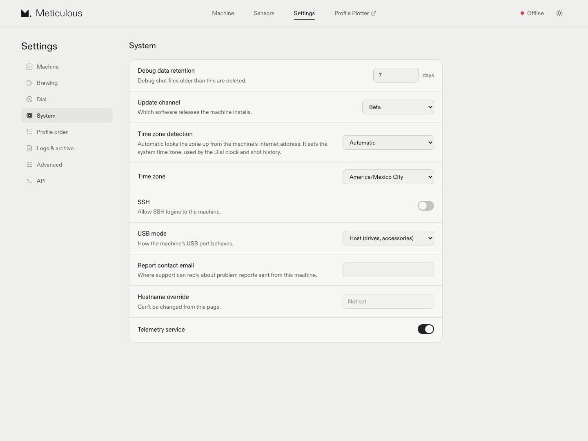
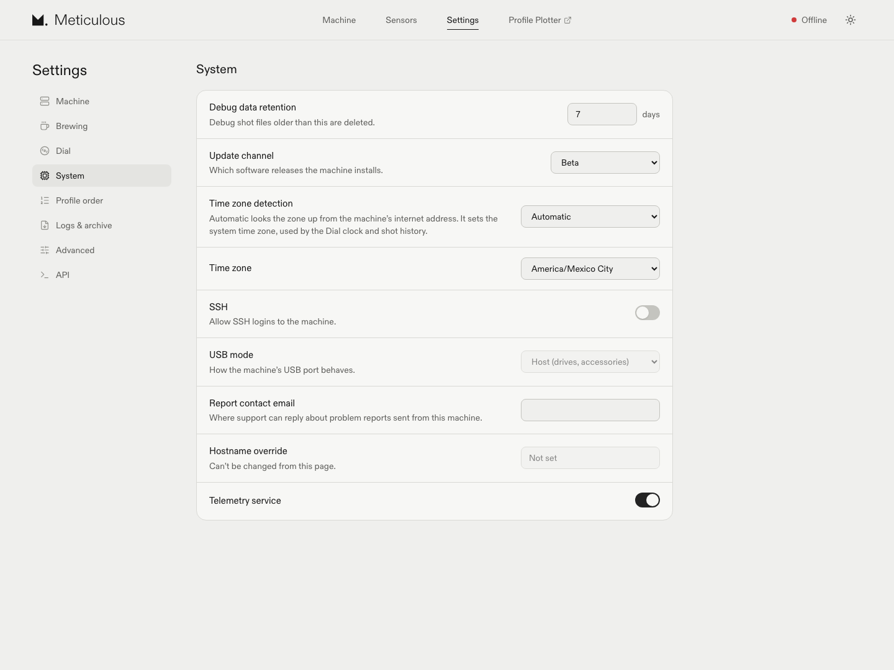

# USB mode UI evidence

Actual Chromium captures of Settings → System with the same 1440×1080 viewport,
light theme and synthetic API settings. No physical machine was used. The Offline
indicator reflects the fixture's lack of a Socket.IO connection.

- Before: meticulous-web-ui beta `75a84ae0a31c73ad6a9cb838b0f34abc8c3b43b6`.
- After: the same source with `disabled` on the USB mode SelectSetting.
- Both captures show the same stored value: Host (drives, accessories).

| Before | After |
| --- | --- |
|  |  |

The baseline browser run selected Client and observed a `usb_mode` POST. The
changed browser run verified the native select is disabled with 0.5 opacity;
mouse click, touchscreen tap, attempted focus, ArrowDown, Space and Enter did
not change its value or emit settings writes. Tab from SSH skipped USB mode and
focused Report contact email. SSH, report contact email and update channel
changes still emitted their expected writes, with no `usb_mode` key.

Reloads with Client, Dual role and an unknown string retained each reported value
in the disabled select. With `usb_mode` absent, the row stayed absent as before.

These are browser checks with intercepted HTTP responses, not backend or
hardware validation. The product change is limited to this settings control.
