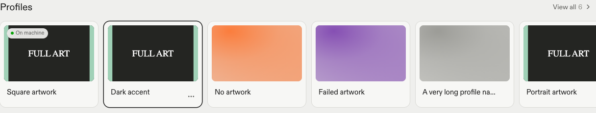
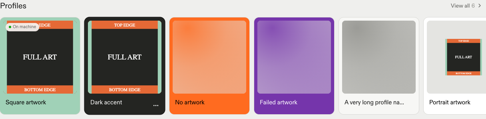
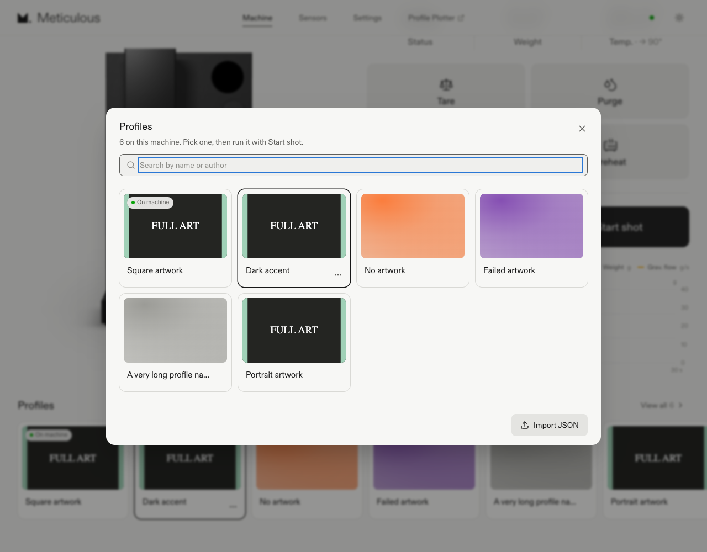
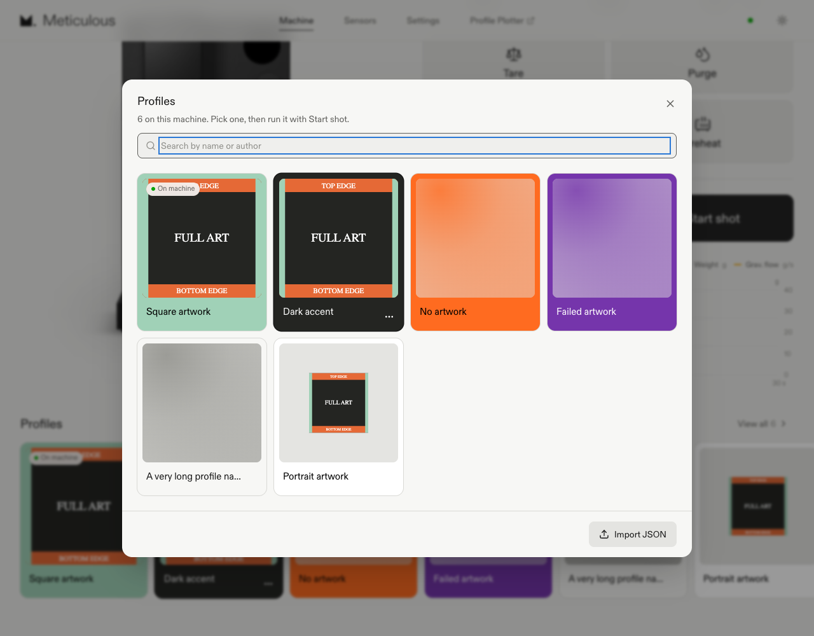
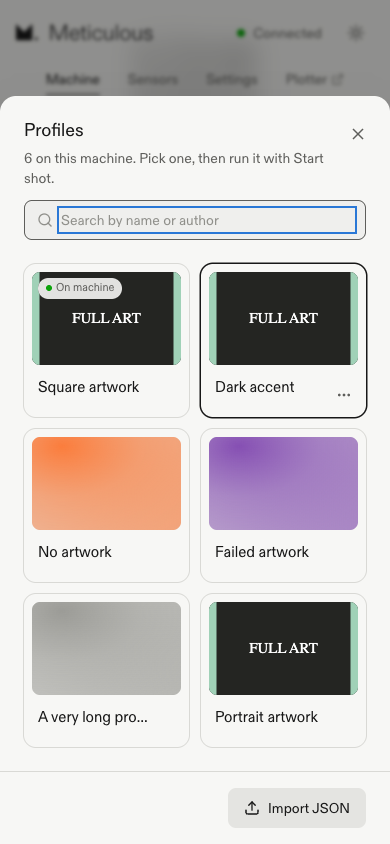
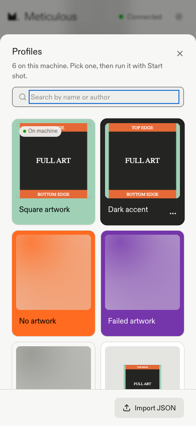
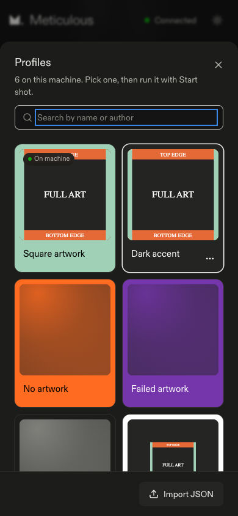

# SW-263 visual evidence

Actual Chromium captures of the web UI, using deterministic synthetic profiles and intercepted API/Socket.IO responses. No physical machine was contacted. The orange top/bottom bands make image cropping visible. Missing and failed images exercise the gradient fallback; light/dark accents and a long name exercise card text and layout.

- Before: `6cecfc8` (full base commit available in the evidence commit parent).
- After: `d548e7c44ed51aea0845637d7a3c29015e2bd8e4`.
- Original visual references: [request and Companion screenshot](https://fffuego.slack.com/archives/C07QN958TGV/p1794944389498379).

| View | Before | After |
| --- | --- | --- |
| Desktop strip |  |  |
| Desktop picker |  |  |
| Mobile picker, 390 px |  |  |

Validation passed: square dimensions and object-contain; no hover scaling; missing/404 image fallback; On machine badge; local selection and picker search/selection; exact downloaded JSON and filename; keyboard menu open/Escape; no profile load or mutation requests; unchanged ShotControls thumbnail object-cover. Picker/card bounds fit at 320, 390, 768, and desktop widths. No browser page errors. Light and dark screenshots inspected.

At 320 px the existing navigation causes document width 328 px both before and after. The picker and cards stay within the viewport. This header issue is outside SW-263.

The capture script uses Playwright and a running development build. With Playwright installed in the script's module search path and Chromium installed, run `node capture.mjs before <baseline-app-url>` or `node capture.mjs after <changed-app-url>`. Optional `PLAYWRIGHT_EXECUTABLE_PATH` selects an installed Chromium. The original execution used Playwright Chromium build 1234 and the checked-in script's assertions. Screenshots are fixture evidence, not hardware acceptance or deployment evidence.
